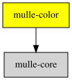

# mulle-hexcolor

#### 🌈 mulle-hexcolor converts between color models

This library defines a `struct CGColor` which is a RGBA representation of a
color with a `float` for red, green, blue, alpha each. The value range for each
color component is 0.0 to 1.0 (inclusive).

You have to trust your optimizing compiler with this library. gcc or clang
should have no problems reducing many of the functions to close to nothing.


#### Color creation

| Name                          | Description
| ------------------------------|-------------------------
| CGColorMake                   | shortcut for CGColorMakeWithRGBA
| CGColorMakeWithRGB            | calls CGColorMakeRGBA which alpha 1.0
| CGColorMakeWithRGBA           | the most basic color construction function
| CGColorMakeWithGray           | construct a gray scale color
| CGColorMakeWithGrayOpaque     | specify a gray level, with alpha implicitly 1.0
| CGColorMakeWithHSLA           |
| CGColorMakeWithHSL            | [https://en.wikipedia.org/wiki/HSL_and_HSV]()
| CGColorMakeWithHSVA           | the alpha level is also 0.0-1.0 (different in most other libraries)
| CGColorMakeWithHSV            |
| CGColorMakeWithHSB            | This is similiar to HSV, but the color components can "overshoot" the 0.0 to 1.0 range, which | can be useful for animation
| CGColorMakeWithHSBA           | [https://learnui.design/blog/the-hsb-color-system-practicioners-primer.html]()
| CGColorMakeRandom             | Sometimes useful for debugging
| CGColorMakeRandomOpaque       |
| CGColorMakeWithUTF8String     | accepts hex color strings like '#fff' but also common color names like "goldenrod"

#### Hex color format

The `CGHexColor` type is a unsigned integer of at least 32bits. It
contains the color in R G B A bytes, where R is shifted by 24 and A not
shifted at all.

`CGHexColor` can be more convenient to use in coding and its smaller in
storage.

| Name                      | Description
|---------------------------|-------------------------
| CGHexColorMakeWithRGBA    | Create a `CGHexColor` from RGBA components
| CGColorGetHexColor        | Get a `CGHexColor` from the RGBA color.
| CGColorMakeWithHexColor   | Create a RGBA color from a `CGHexColor`

#### Alpha information functions

| Name                         | Description
|------------------------------|-------------------------
| CGAlphaIsTransparent         |
| CGAlphaIsOpaque              |

#### Color information functions

| Name                         | Description
|------------------------------|-------------------------
| CGColorGetNumberOfComponents |
| CGColorGetComponents         |
| CGColorGetGray               | the gray level is actually not just (r+g+b) / 3, but rather
| CGColorGetAlpha              |
| CGColorGetHSLAComponents     |
| CGColorGetHSVAComponents     |
| CGColorGetHSBAComponents     |
| CGColorIsTransparent         |
| CGColorIsOpaque              |
| CGColorEqualToColor          |

#### Color operations

| Name                         | Description
|------------------------------|-------------------------
| CGColorMakeDimmedColor       | Turn down the brightness by a specific value
| CGColorMakeBrightenedColor   | Turn up the brigness by a specific value


| Release Version                                       | Release Notes
|-------------------------------------------------------|--------------
|  [](//github.com/mulle-gfx/mulle-hexcolor/actions) | [RELEASENOTES](RELEASENOTES.md) |


### You are here




## Add

**This project is a component of the [mulle-core](//github.com/mulle-core/mulle-core) library. As such you usually will *not* add or install it
individually, unless you specifically do not want to link against
`mulle-core`.**


### Add as an individual component

Use [mulle-sde](//github.com/mulle-sde) to add mulle-hexcolor to your project:

``` sh
mulle-sde add github:mulle-gfx/mulle-hexcolor
```

To only add the sources of mulle-hexcolor with dependency
sources use [clib](https://github.com/clibs/clib):


``` sh
clib install --out src/mulle-gfx mulle-gfx/mulle-hexcolor
```

Add `-isystem src/mulle-gfx` to your `CFLAGS` and compile all the sources that were downloaded with your project.


## Install

### Install with mulle-sde

Use [mulle-sde](//github.com/mulle-sde) to build and install mulle-hexcolor and all dependencies:

``` sh
mulle-sde install --prefix /usr/local \
   https://github.com/mulle-gfx/mulle-hexcolor/archive/latest.tar.gz
```

### Manual Installation

Install the requirements:

| Requirements                                 | Description
|----------------------------------------------|-----------------------
| [mulle-core](https://github.com/mulle-core/mulle-core)             | 🌋 Almagamated library of mulle-core and mulle-c

Install **mulle-hexcolor** into `/usr/local` with [cmake](https://cmake.org):

``` sh
cmake -B build \
      -DCMAKE_INSTALL_PREFIX=/usr/local \
      -DCMAKE_PREFIX_PATH=/usr/local \
      -DCMAKE_BUILD_TYPE=Release &&
cmake --build build --config Release &&
cmake --install build --config Release
```


## Author

[Nat!](https://mulle-kybernetik.com/weblog) for Mulle kybernetiK  


